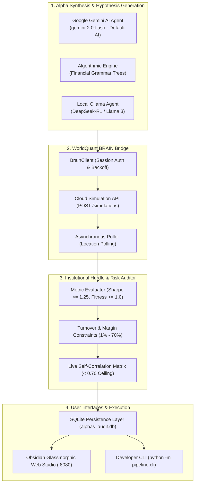

# WorldQuant Alpha Miner

[](https://www.python.org/downloads/)
[](https://fastapi.tiangolo.com/)
[](https://opensource.org/licenses/MIT)
[](https://worldquantbrain.com/)
[](https://aistudio.google.com/)
[-black.svg)](https://ollama.ai/)

An institutional-grade algorithmic quantitative research studio, simulation runner, and execution pipeline built for **WorldQuant BRAIN**. 

Designed to automate the full quantitative alpha discovery lifecycle: from multi-factor hypothesis formulation and cloud simulation to platform hurdle auditing, real-time portfolio self-correlation defense, and interactive web visualization.

---

## 🏛️ Architecture & Lifecycle



---

## 🌟 Key Capabilities

### 1. 🛡️ Real-Time Self-Correlation Defense
WorldQuant BRAIN permanently rejects any submitted alpha whose correlation with **any existing active alpha in your portfolio is $\ge 0.70$**.
- This pipeline intercepts simulation results and queries `/alphas/{id}/check` to compute real-time cross-correlation against every active alpha in the user's live portfolio.
- Non-orthogonal candidates (e.g. sharing standard operating income or 5-day reversal weights) are automatically flagged as `Submittable: False` to safeguard your daily submission quota.

### 2. 🤖 Multi-Engine Alpha Synthesis
- **Institutional Quant V2 Engine (`pipeline/engine_institutional.py`)**: Institutional non-linear power-ranked factor synthesis (Akshat Kumar integration). Implements tail concentration ($\text{power}(\text{rank}, 2.5)$), analytical decay optimization ($\tau \in [22, 24]$), and multi-dataset financial interaction grammar (Novy-Marx Gross Profitability, Sloan Accruals, and Consensus EPS Momentum). Delivered verified `SPECTACULAR` (Sharpe 2.39, Fitness 2.55) and `EXCELLENT` (Sharpe 2.28, Fitness 2.38) alphas.
- **Google Gemini Quant Agent (Primary Default AI)**: High-speed, frontier factor formulation using Google's `gemini-2.0-flash` (free tier via Google AI Studio). Formulates multi-horizon expressions with sector neutralization and power-weighting.
- **Algorithmic Engine**: Deterministic quantitative generator employing multi-factor financial trees (Capital Efficiency, Novy-Marx Gross Profitability, Free Cash Flow Yield, PEAD, Repurchases, and Alternative Data Network graphs).
- **Free Local Ollama Agent**: Runs private open-source models (such as `deepseek-r1:latest` or `llama3`) on local hardware via `http://localhost:11434` without needing external API keys.

### 3. ⚡ Resilient Institutional Client (`pipeline/client.py`)
- Automatically negotiates session cookies and JWT authentication with WorldQuant BRAIN.
- Built-in retry mechanism with exponential backoff on HTTP `429 Too Many Requests`.
- Auto-reauthenticates on HTTP `401 Unauthorized` token expiration without dropping simulation queues.

### 4. 📊 Obsidian Glassmorphic Web Studio (`web/`)
- **Executive Dashboard**: Animated KPIs, Tier Badges (**Spectacular**, **Excellent**, **Good**), Risk-Return scatter frontier, and active portfolio tracking.
- **Head-to-Head Compare**: Side-by-side metric diffing with green highlight markers and formula cloning.
- **Data Catalog Explorer**: Instant search across 4,367 data fields over 14 institutional datasets (`analyst4`, `fundamental6`, `pv13`, `news18`, `option8`) with one-click cursor insertion.
- **Factor Health Radar**: In-modal 6-axis radar visualizing Sharpe, Fitness, Return, Turnover Control, Margin, and Drawdown.

### 5. 💻 Developer CLI (`pipeline/cli.py`)
- Run batch simulations, audit specific alphas, inspect active portfolio standing, or generate new candidates directly from the command line.

---

## 🚀 Quick Start

### 1. Clone the Repository
```bash
git clone https://github.com/Ashwin-anand-dot/brain-alpha-github.git
cd brain-alpha-github
```

### 2. Install Dependencies
```bash
python3 -m venv venv
source venv/bin/activate
pip install -r requirements.txt
```

### 3. Configure Credentials
Copy the environment template and enter your WorldQuant BRAIN login:
```bash
cp .env.example .env
```
Edit `.env`:
```ini
BRAIN_EMAIL=your_email@example.com
BRAIN_PASSWORD=your_brain_password
```

### 4. Launch the Web Studio
```bash
./start.sh
```
Open **[http://localhost:8080](http://localhost:8080)** in your browser.

---

## 💻 Command-Line Usage (Headless Mode)

Generate alphas from terminal:
```bash
# Default AI generation (Google Gemini - gemini-2.0-flash)
python3 -m pipeline.cli --generate gemini --count 3

# Algorithmic generation (zero AI / pure math trees)
python3 -m pipeline.cli --generate algorithmic --count 3

# Local Ollama generation (private offline LLM)
python3 -m pipeline.cli --generate ollama --model deepseek-r1:latest --count 2

# Institutional V2 generation (tail-concentration & Novy-Marx + Sloan grammar)
python3 -m pipeline.cli --generate institutional --count 1

# Empirical Benchmark Comparison (Baseline Templates vs. Institutional Engine)
python3 -m pipeline.cli --benchmark
```

Simulate an educational candidate batch:
```bash
python3 -m pipeline.cli --simulate-file examples/candidates_example.json
```

Check live portfolio status:
```bash
python3 -m pipeline.cli --portfolio-status
```

Institutional Whitepaper & Benchmark Report:
See [QUANT_RESEARCH_UPGRADE.md](QUANT_RESEARCH_UPGRADE.md) for full econometric diffs and mathematical proofs.

---

## 🧪 Automated Test Suite

Run the built-in unit test suite (no external credentials required):
```bash
python3 -m unittest discover -s tests -v
```

---

## 📐 WorldQuant BRAIN Platform Hurdles

To pass institutional submission checks on WorldQuant BRAIN, an alpha must strictly satisfy 100% of the following requirements:

| Hurdle | Threshold | Description |
| :--- | :---: | :--- |
| **LOW_SHARPE** | $\ge 1.25$ | Annualized risk-adjusted excess returns over 5-year in-sample window (`2019`–`2023`). |
| **LOW_FITNESS** | $\ge 1.00$ | Strategy efficiency: $\text{Fitness} \approx \text{Sharpe} \times \sqrt{\frac{\|\text{Annualized Returns}\|}{\text{Turnover}}}$. |
| **TURNOVER** | $1.0\% - 70.0\%$ | Balances active factor rebalancing against real-world transaction costs. |
| **SELF_CORRELATION** | $< 0.70$ | Maximum Pearson correlation against all existing active portfolio alphas. |
| **SUB_UNIVERSE_SHARPE** | $\ge \text{Limit}$ | Validates performance across market-cap cuts (`TOP500`, `TOP1000`, `TOP2000`). |
| **CONCENTRATED_WEIGHT** | $\le 10.0\%$ | Position weights must be well-diversified across hundreds of securities. |
| **MARGIN** | $> 0$ bps | Positive profit per dollar volume traded. |

---

## 📂 Project Structure

```
brain-alpha-github/
├── .env.example              # Documented environment variables blueprint
├── .gitignore                # Production exclusions (protects secrets & private alphas)
├── Dockerfile                # Container deployment definition
├── LICENSE                   # MIT License
├── README.md                 # Project documentation
├── requirements.txt          # Python dependencies
├── server.py                 # Root FastAPI entrypoint
├── start.sh                  # One-click launch script
│
├── data/                     # WorldQuant metadata catalogs
│   ├── datasets_catalog.csv
│   └── data_fields_catalog.csv
│
├── examples/                 # Educational sanitized templates
│   └── candidates_example.json
│
├── pipeline/                 # Core quantitative engines
│   ├── alpha_factory.py      # Multi-factor composition templates
│   ├── cli.py                # Command-line interface
│   ├── client.py             # WorldQuant BRAIN API client
│   ├── config.py             # Platform thresholds & simulation parameters
│   ├── database.py           # SQLite persistence layer
│   ├── engine_ai.py          # Multi-LLM engine (Ollama, Gemini, OpenAI)
│   ├── engine_algorithmic.py # Financial grammar tree synthesis
│   ├── evaluator.py          # Platform hurdle auditing & correlation verification
│   └── reporter.py           # Terminal scorecard formatter
│
├── tests/                    # Automated unit tests
│   ├── test_config.py
│   ├── test_engines.py
│   └── test_evaluator.py
│
└── web/                      # Web application & UI
    ├── server.py             # REST API routes & background task manager
    ├── static/               # Glassmorphic stylesheet & Particles.js engine
    └── templates/            # Single-page application templates
```

---

## 🔒 Security & Privacy Notice

- **No Secrets Tracked**: This repository strictly enforces `.gitignore` rules preventing `.env` files or API credentials from being committed.
- **Simulate-Only Safety Rule**: Alphas are never submitted automatically. Every submission to live portfolios requires explicit user confirmation.

---

## 📜 License

This project is licensed under the [MIT License](LICENSE).
